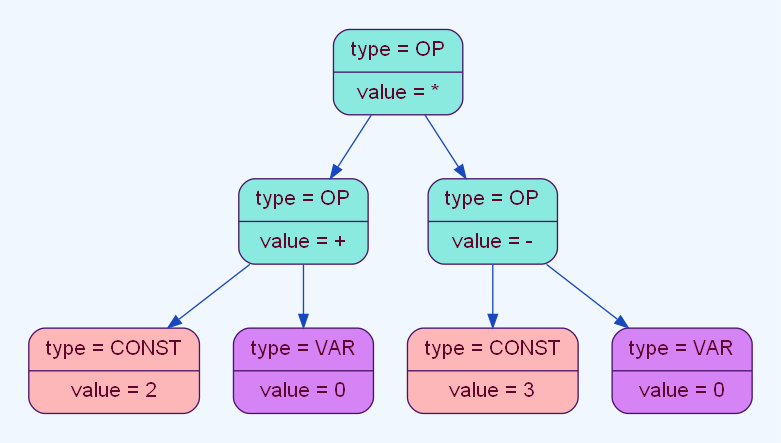
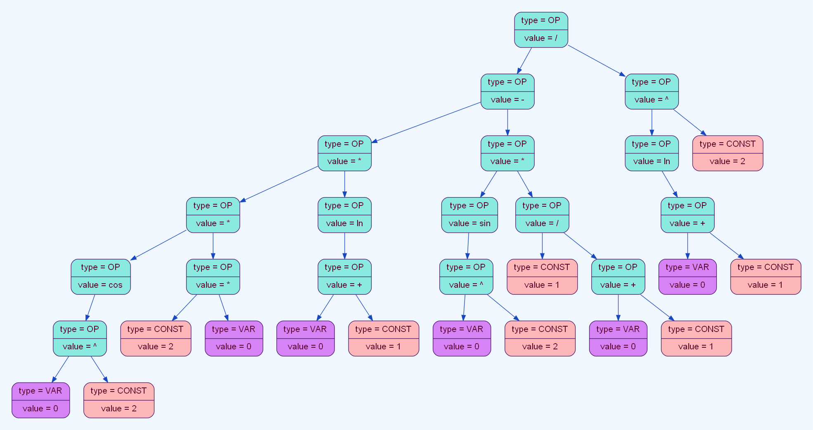
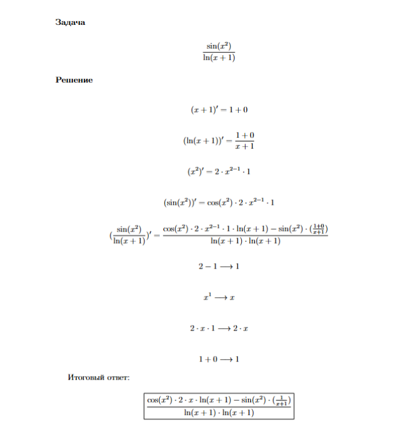

# Дифференциатор

Проект реализует дифференциатор, который позволяет считать производные и получать полный ход решения.
Основная структура данных, на которой основано дифференцирование - бинарное дерево.
Проект написан на языке программирования СИ.
## Автор: Екатерина Краева
## Ментор: Павел Тараканов

## Компиляция и запуск
```
g++ -g -Wshadow -Winit-self -Wredundant-decls -Wcast-align -Wundef -Wfloat-equal -Winline -Wunreachable-code -Wmissing-declarations -Wmissing-include-dirs -Wswitch-enum -Wswitch-default -Weffc++ -Wmain -Wextra -Wall -g -pipe -fexceptions -Wcast-qual -Wconversion -Wctor-dtor-privacy -Wempty-body -Wformat-security -Wformat=2 -Wignored-qualifiers -Wlogical-op -Wno-missing-field-initializers -Wnon-virtual-dtor -Woverloaded-virtual -Wpointer-arith -Wsign-promo -Wstack-usage=8192 -Wstrict-aliasing -Wstrict-null-sentinel -Wtype-limits -Wwrite-strings -Werror=vla -D_DEBUG -D_EJUDGE_CLIENT_SIDE differentiator.cpp -o differentiator.exe
```
```
.\differentiator.exe input2.txt differentiator.tex
```

## Структура проекта

|Файл|Назначение|
|:-|:-|
|differentiator.h|Структуры данных, объявления функций и макросы|
|binary-tree.cpp|Операций с бинарным деревом, чтение и запись|
|differentiator.cpp|Функции, связанные с дифференцированием|
|graphics.cpp|Построение графического представления дерева|
|DSL.cpp|Полное DSL проекта|
|tex-settings.cpp|Формирование отчёта в формате '.tex'|
|simplifies.cpp|Функции упрощения выражений в отчёте|

## Структура бинарного дерева
```
struct Node{
    NodeType type;
    double value;
    Node* left;
    Node* right;
    Node* parent;
};

struct BinaryTree_t{
    Node* root;
    size_t dim;
};
```

Бинарное дерево имеет три типа узлов:
- OP (операция)
- VAR (переменная)
- CONST (числовая константа)

## Дифференцирование

Функция Diff обходит исходное дерево и строит новое дерево производной.
Для каждой операции применяется соответствующее правило дифференцирования.
Операции, которые поддерживаются:
- ADD
- SUB
- DIV
- SIN
- COS
- CTG
- EXP
- POW
- LOG
- ARCSIN
- ARCCOS
- ARCTG
- ARCCTG

Функция определяет тип текущего узла и выбирает соответствующее правило дифференцирования.

Если текущий узел является числовой константой, возвращается новый узел со значением ноль.

Если текущий узел является переменной, возвращается новый узел со значением единица.

Если текущий узел является операцией, программа определяет её код и применяет соответствующее математическое правило.

Чтобы не перегружать функцию, используется DSL-система.

Новые узлы производной создаются с помощью функции createNewDiffNode.

Таким образом, исходное дерево остаётся неизменным, а результат дифференцирования формируется в отдельном дереве diffTree.

## DSL

Проект использует систему DSL.

Пример:
```
#define _C(value) createNewDiffNode(binaryTree, MY_CONST, value, NULL, NULL)
#define _DL Diff(binaryTree, node->left, file)
#define _DR Diff(binaryTree, node->right, file)
#define _CL copyNode(binaryTree, node->left)
#define _CR copyNode(binaryTree, node->right)

#define _ADD(left, right) createNewDiffNode(binaryTree, OP, ADD, left, right)
#define _SUB(left, right) createNewDiffNode(binaryTree, OP, SUB, left, right)
#define _MUL(left, right) createNewDiffNode(binaryTree, OP, MUL, left, right)
#define _DIV(left, right) createNewDiffNode(binaryTree, OP, DIV, left, right)

#define _POW(left, right) createNewDiffNode(binaryTree, OP, POW, left, right)
#define _LOG(base, argument) createNewDiffNode(binaryTree, OP, LOG, base, argument)

```

## Графика

Графическое представления делает представление удобным для отладки. Разные типы узлов подсвечены разными цветами.

Графическая реализация использует библиотеку ```Graphviz```.

Документация: https://www.graphviz.org/documentation/

Используемый гайд: https://lib.custis.ru/Graphviz

Картинки создаются командой ```dot graph.txt -Tpng -o binary-tree-picture.png``` через ```system```.

### Пример картинки дерева исходного выражения


### Пример картинки дерева дифференцированного выражения


### Пример сформированного отчёта

